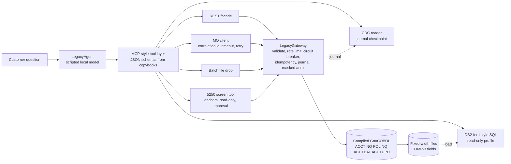

# Agents and legacy systems: COBOL, AS/400 green screens, MQ, DB2 for i

> **Recruiter summary.** Most core banking and insurance data still lives in COBOL programs and
> IBM i (AS/400) applications that have no modern API. This repo shows seven working ways an AI agent
> can reach those systems safely: real COBOL compiled with GnuCOBOL, a copybook codec (EBCDIC and
> packed decimal), a REST facade, batch file drops, MQ-style request/reply, a 5250 green-screen
> scraper with drift detection and human approval for writes, read-only DB2-style SQL, and change data
> capture. Everything runs free on a laptop. Measured: 10,000/10,000 copybook round trips, 0 wrong
> answers during a simulated outage, 159 duplicate writes blocked, and 20/20 screen layout shifts caught.

Two fictional companies supply the data: **Harbor Ridge Savings** (a regional bank, accounts) and
**Lakeshore Mutual** (an insurer, policies). All names and emails are synthetic.

## Contents
- [Purpose](docs/purpose.md) and [mainframe primer for non-mainframe readers](docs/mainframe-primer.md)
- [Architecture](docs/architecture.md) and [how each pattern works](docs/patterns.md)
- [Choosing a pattern](docs/choosing-a-pattern.md)
- [Running it](docs/running.md), [guardrails](docs/guardrails.md), [threat model](docs/threat-model.md)
- [Limitations](docs/limitations.md), [implementation guide](docs/implementation-guide.md), [interview points](docs/interview-points.md)
- [Measured results](docs/results.md) and ADRs in [docs/adr](docs/adr)

## Architecture



## The seven patterns

| # | Pattern | When it fits | Code |
| --- | --- | --- | --- |
| 1 | COBOL programs + copybook codec | You can call the program and read its records | `cobol/`, `copybook.py`, `cobol.py` |
| 2 | REST API facade | Low-latency single lookups for many callers | `facade.py` |
| 3 | Batch file drop | Hundreds or thousands of records, minutes are fine | `gateway.batch_lookup`, `ACCTBAT.cbl` |
| 4 | MQ request/reply | The shop already integrates over queues | `mq.py` |
| 5 | 5250 screen scraping | No API, no queue, no database access: only the terminal | `screen.py`, `screen_agent.py` |
| 6 | DB2-for-i style SQL | Read-only reporting over many rows | `sql.py` |
| 7 | Change data capture | The agent must react to changes, not poll | `cdc.py` |

## Measured results

<!-- results:start -->
**Tests: 184** (pytest, all passing). Numbers below come from `legacyagents bench` on one Linux machine;
latency varies by machine, every other number is deterministic and checked in CI.

| Pattern | Calls | p50 ms | p95 ms |
| --- | --- | --- | --- |
| COBOL program call (ACCTINQ) | 40 | 1.99 | 2.33 |
| REST API facade -> COBOL | 40 | 3.01 | 3.56 |
| MQ request/reply -> COBOL (POLINQ) | 40 | 2.06 | 2.42 |
| 5250 screen scrape (sign-on to detail) | 40 | 1.99 | 2.32 |
| DB2-for-i style SQL (SQLite) | 40 | 0.22 | 0.29 |
| Batch file drop, 100 accounts (ACCTBAT) | 10 | 2.73 | 2.79 |

Batch cost per account: 0.027 ms. CDC event lag (journal write to agent): p50 0.6 ms,
max 0.9 ms over 20 changes.

| Check | Result |
| --- | --- |
| Copybook round trip, 10,000 random account records (dict, bytes, EBCDIC) | 10,000 / 10,000 / 10,000 (100.0%) |
| Records read back by the compiled COBOL program equal the source | 200/200 |
| Policy records round trip | 100/100 |
| Outage: 40 questions while COBOL is down | 5 reached legacy, 35 short-circuited, 40 safe answers, 0 wrong |
| Recovery after breaker cooldown | True (breaker closed) |
| Idempotency: 210 write attempts for 51 unique writes | 51 applied, 159 duplicates prevented |
| MQ with 30% of requests dropped, 50 requests | 50 answered correctly in 76 attempts, 0 gave up |
| Rate limit: burst of 30 against a bucket of 10 | 10 allowed, 20 rejected, 10 legacy calls |
| Agent routing, 22 labelled questions (regression check) | 22/22 |
| Writes without human approval | 0 |
| Planted PII values found in audit log or trace | 0 of 4 |

Screen layout drift (20 reads per layout; v2 shifts fields, v3 renames a label):

| Layout | Reads | Naive scraper silently wrong | Guarded scraper detected drift | Guarded wrong | Relocate-by-label correct |
| --- | --- | --- | --- | --- | --- |
| v1 | 20 | 0 | 0 | 0 | 20 |
| v2 | 20 | 20 | 20 | 0 | 20 |
| v3 | 20 | 0 | 20 | 0 | 0 |

Write guardrails: read-only tool refused = True, no approval leaves it pending =
True, write on a drifted screen refused = True.
<!-- results:end -->

## Real code and output

The COBOL inquiry program reads the master file record by record, like the original batch code would:

```cobol
           PERFORM UNTIL WS-EOF = "Y" OR WS-FOUND = "Y"
               READ ACCT-FILE
                   AT END MOVE "Y" TO WS-EOF
                   NOT AT END
                       IF ACCT-ID = WS-KEY
                           MOVE "Y" TO WS-FOUND
                       END-IF
               END-READ
           END-PERFORM
```

Its copybook carries a packed-decimal balance that the Python codec unpacks:

```cobol
       01  ACCT-REC.
           05  ACCT-ID             PIC X(10).
           05  ACCT-NAME           PIC X(30).
           05  ACCT-TYPE           PIC X(1).
           05  ACCT-BALANCE        PIC S9(9)V99 COMP-3.
           05  ACCT-OPEN-DATE      PIC 9(8).
           05  ACCT-STATUS         PIC X(1).
           05  ACCT-EMAIL          PIC X(40).
```

`legacyagents demo` (real output):

```text
Q: What's the balance on HR00100003?
   tool=get_account_balance  A: Account HR00100003 has a balance of $19334.19.
Q: Is policy LM-002000004 still active?
   tool=get_policy  A: Policy LM-002000004 is active, premium $7016.48, renews 20270903.
Q: Compare HR00100001 and HR00100005
   tool=batch_account_lookup  A: Checked 2 accounts; 1 are open: HR00100001 $122204.83
Q: List active accounts over $200,000
   tool=query_accounts_sql  A: 33 accounts match.
Q: Please freeze HR00100007, my card was stolen
   tool=screen_update_status  A: That change needs approval from a staff member before I can make it.
   (supervisor approves CHG-1001)
Q: Please freeze HR00100007, my card was stolen
   A: Done: Status changed.
Q: What changed on accounts today?
   A: 1 account changes since I last looked.
```

## Run it

```bash
sudo apt-get install -y gnucobol        # free; macOS: brew install gnucobol
python -m venv .venv && . .venv/bin/activate
pip install -e ".[dev]"
pytest -q                               # compiles the COBOL on first use
legacyagents demo
legacyagents bench --out results.json && python scripts/render_docs.py
```

No cloud, no paid services, no network beyond 127.0.0.1.

## Built vs planned

| Item | Status |
| --- | --- |
| Four COBOL programs compiled and run with GnuCOBOL 3.x | Built |
| Copybook parser: PIC X / 9 / S9 / V, DISPLAY with overpunch sign, COMP-3, COMP; EBCDIC cp037 | Built |
| REST facade, batch file drop, in-process MQ request/reply, CDC from a journal | Built |
| 5250-style screen simulator, guarded scraper, drift detection, approval-gated writes | Built |
| DB2-for-i style SQL on SQLite with a read-only profile | Built |
| Rate limit, circuit breaker, idempotency, masked hash-chained audit log | Built |
| Scripted local model choosing the legacy path | Built (rules, not an LLM) |
| OCCURS, REDEFINES, level-88 in copybooks | Planned (parser refuses them today) |
| RabbitMQ (free) behind the same client interface | Planned |
| Real IBM i, real 5250 data stream (TN5250), real DB2 for i over JDBC/ODBC | Planned; simulated here |
| z/OS connection (CICS, IMS, z/OS Connect) | Planned; simulated with GnuCOBOL |
| IBM MQ | Planned; simulated with an in-process broker |
| A real LLM choosing tools | Planned; would replace `ScriptedModel.plan` only |

## Related repos
- [Jagadish-pii-guard](https://github.com/jagadishmazure-jpg/Jagadish-pii-guard): PII detection and tokenization used in the same spirit as the masking here.
- [Jagadish-ai-system-design-at-scale](https://github.com/jagadishmazure-jpg/Jagadish-ai-system-design-at-scale): circuit breakers, rate limits and outage drills at service scale.
- [Jagadish-agent-auth-security](https://github.com/jagadishmazure-jpg/Jagadish-agent-auth-security): least-privilege tool access and approvals.

MIT licensed. See [SECURITY.md](SECURITY.md).
