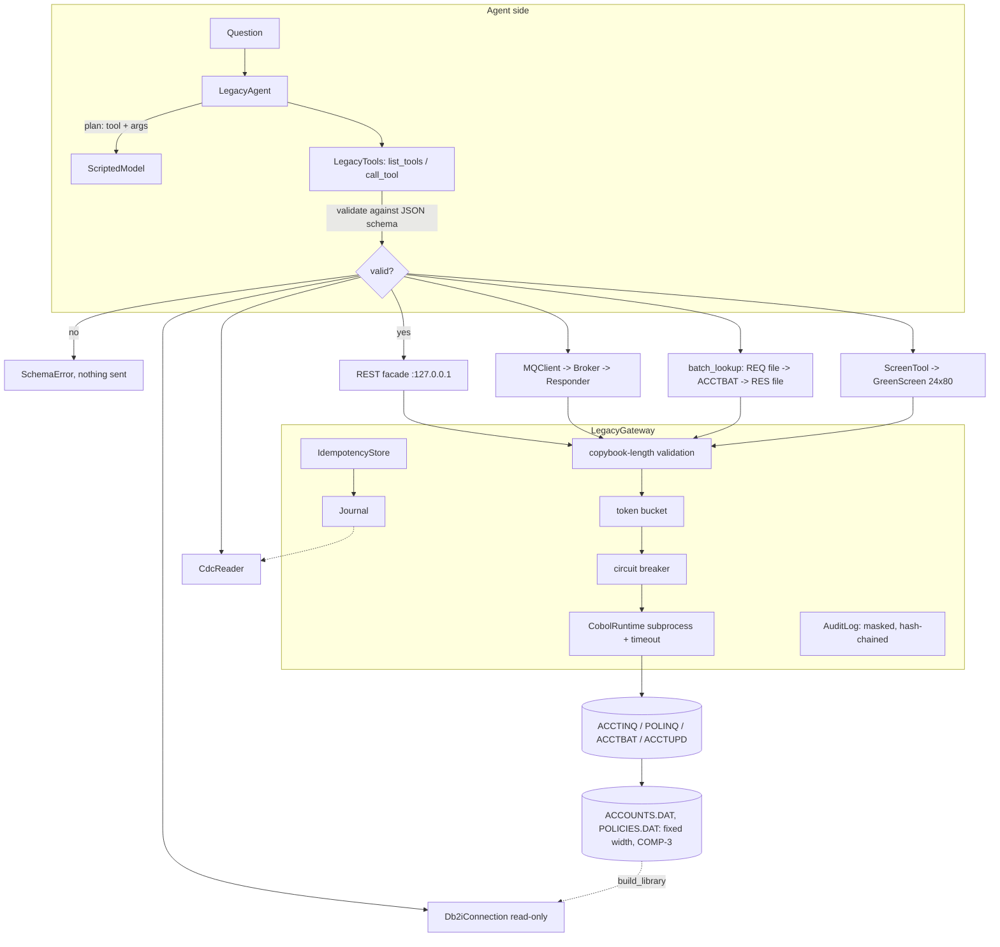

# Architecture

## Components

| Module | Role |
| --- | --- |
| `cobol/*.cbl`, `cobol/copybooks/*.cpy` | The "legacy system": four real COBOL programs and their record layouts |
| `copybook.py` | Parses copybooks; encodes and decodes records (ASCII or EBCDIC, COMP-3, COMP, zoned) |
| `cobol.py` | Compiles with `cobc`, runs a program with a timeout, maps files through environment variables (how GnuCOBOL resolves `ASSIGN TO` names) |
| `gateway.py` | The one door: validation, rate limit, breaker, idempotent writes, journal, audit |
| `facade.py` | Pattern 2, REST over the gateway |
| `mq.py` | Pattern 4, broker, mainframe-side responder, client with correlation ids |
| `screen.py`, `screen_agent.py` | Pattern 5, terminal simulator and guarded scraper |
| `sql.py` | Pattern 6, DB2-for-i conventions on SQLite, read-only |
| `cdc.py` | Pattern 7, journal follower with checkpoints |
| `tools.py` | MCP-style tool catalogue with JSON schemas |
| `agent.py` | Question to tool choice to plain answer, with safe failure |
| `bench.py` | Every number in the README |

## Why everything funnels through one gateway
Each pattern is a different *transport*, but the risks are the same: a fragile host, exact field
formats, money, personal data. Putting validation, throttling, the breaker and the audit trail in
one place means a new pattern inherits them for free and a reviewer has one file to read. The SQL
path is the exception because it reads a copy (see ADR 0003).
